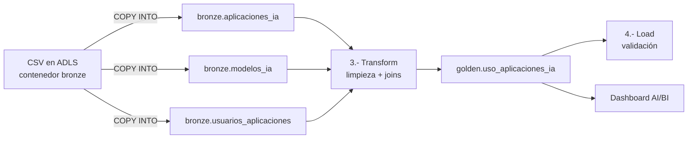
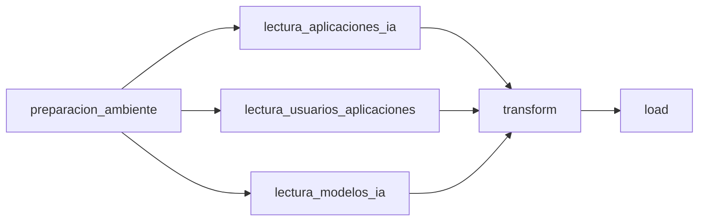

# Proyecto: Uso de Aplicaciones de IA – Arquitectura Medallion en Azure Databricks

> **¿Quién usa realmente la Inteligencia Artificial, en qué la usa y con qué modelos?**

## La inspiración

Cada semana aparece un nuevo modelo de IA: Anthropic, Google, Meta, OpenAI, Mistral, NVIDIA y xAI compiten por llevar sus modelos a las empresas. Detrás de cada lanzamiento hay una pregunta que pocos responden con datos: **¿qué pasa después?** ¿Llegan esos modelos a aplicaciones reales? ¿Qué sectores los están adoptando? ¿Cuántas horas al mes los usan las personas?

Este proyecto nace de esa curiosidad: seguir el recorrido completo de la IA, **del modelo a la aplicación y de la aplicación al usuario final**, y convertirlo en un tablero que cualquiera pueda leer en segundos.

## La historia que cuentan los datos

El proyecto se apoya en tres conjuntos de datos que, unidos, forman una cadena de valor:

| Tabla | Qué representa | Volumen | Campos clave |
| --- | --- | --- | --- |
| `modelos_ia` | El catálogo de modelos de IA: quién los construyó, de qué tipo son y cuándo se lanzaron | 20 modelos de 10 empresas (2021–2026) | `tipo_modelo` (RAG, Code, Vision, LLM, Multimodal), `empresa`, `anio_lanzamiento` |
| `aplicaciones_ia` | Las aplicaciones que ponen esos modelos a trabajar en un negocio | 100 aplicaciones en 8 sectores | `sector` (Salud, Retail, Atención al cliente, Marketing, Legal, Manufactura, Finanzas, Educación), `id_modelo` |
| `usuarios_aplicaciones` | Las personas que usan esas aplicaciones y cuánto las usan | 1.000 usuarios en 7 países de Latinoamérica | `pais`, `uso_mensual_horas` (5 a 80 h) |

Al cruzarlas aparecen hallazgos interesantes:

* **RAG domina la adopción:** el 45 % de los usuarios trabaja con aplicaciones basadas en modelos RAG (generación aumentada con recuperación), seguidos por Vision (26 %) y Code (25 %).
* **Salud lidera en intensidad de uso:** es el sector con más horas acumuladas, por delante de Retail y Atención al cliente.
* **La IA ya es hábito:** el usuario promedio dedica unas 42 horas al mes a estas aplicaciones, y casi 4 de cada 10 usuarios están en la categoría de uso **Alto** (50 h o más).
* **Una mirada regional:** Colombia, Ecuador, México, Chile y Perú concentran la mayor parte de los usuarios.

El resultado final es la tabla `catalog_au.golden.uso_aplicaciones_ia`, que une modelo, aplicación y usuario en una sola fila, y el dashboard que la convierte en información para la toma de decisiones.

## Cómo se construyó

A continuación se documenta, con evidencias, la construcción del proceso de punta a punta en Azure Databricks: preparación del ambiente, ingesta (bronze), transformación, capa golden, orquestación con Lakeflow Jobs y el dashboard final.

* **Autor / workspace:** gamellori@hotmail.com
* **Nube:** Azure (ADLS Gen2, cuenta de almacenamiento `stgproyectollori`)
* **Catálogo Unity Catalog:** `catalog_au`
* **Esquemas:** `raw`, `bronze`, `silver`, `golden`

---

## 1. Estructura del espacio de trabajo

| Carpeta | Contenido |
| --- | --- |
| `PrepAmb/` | Notebooks del pipeline (preparación, ingesta, transformación y carga) |
| `datasets/` | Archivos fuente: `aplicaciones_ia.csv`, `modelos_ia.csv`, `usuarios_aplicaciones.csv` |
| `dashboard/` | Evidencias del dashboard final |
| `evidencias/` | Capturas de pantalla de cada etapa del proceso |
| `certificaciones/` | Certificaciones obtenidas (`Tres certificaciones.png`) |
| `proceso/`, `seguridad/`, `reversion/`, `delta-sharing/` | Material complementario del proyecto |

---

## 2. Arquitectura del proceso

**Evidencia – Orquestación del proceso**

---

## 3. Etapas del proceso

### 3.1 Preparación del ambiente – `PrepAmb/1.- Preparacion_Ambiente`

* Crea las External Locations sobre ADLS con la credencial `credential-1307`: `extl-metastore`, `exlt-raw`, `extl-bronze`, `extl-silver`, `extl-gold`.
* Crea el catálogo `catalog_au` y los esquemas `raw`, `bronze`, `silver`, `golden`.
* Crea las tablas Delta bronze: `aplicaciones_ia`, `modelos_ia`, `usuarios_aplicaciones`.

Evidencias: ver sección 6.1.

### 3.2 Ingesta bronze – tres ramas de lectura en paralelo

| Notebook | Tabla destino | Filas cargadas |
| --- | --- | --- |
| `2.- aplicaciones_ia` | `catalog_au.bronze.aplicaciones_ia` | 100 |
| `2- modelos_ia` | `catalog_au.bronze.modelos_ia` | 20 |
| `2.-  usuarios_aplicaciones` | `catalog_au.bronze.usuarios_aplicaciones` | 1.000 |

Cada notebook usa `COPY INTO` desde `abfss://bronze@stgproyectollori.dfs.core.windows.net/<archivo>.csv` con casteo de tipos (`anio_lanzamiento`, `uso_mensual_horas`).

Evidencias: ver secciones 6.1 y 6.2.

### 3.3 Transformación – `PrepAmb/3.- Transform` (Scala)

* Limpieza: `trim` de columnas, descarte de claves nulas, `dropDuplicates` por llave.
* Filtro de calidad: `uso_mensual_horas > 0`.
* Joins: usuarios → aplicaciones (`id_aplicacion`) → modelos (`id_modelo`).
* Columnas derivadas:
  * `categoria_uso`: Bajo (< 20 h), Medio (20–49 h), Alto (>= 50 h)
  * `antiguedad_modelo_anios` = año actual − `anio_lanzamiento`
  * `fecha_carga` = timestamp de la carga
* Escritura Delta en modo overwrite en `catalog_au.golden.uso_aplicaciones_ia`.

Evidencias: ver sección 6.3.

### 3.4 Carga y validación – `PrepAmb/4.- Load`

Valida la tabla golden (filas y usuarios únicos) y presenta la agregación por `sector` y `tipo_modelo`.

Resultado de la última validación registrada (1.000 usuarios en total):

| Sector | Tipo modelo | Usuarios | Uso promedio (h) |
| --- | --- | --- | --- |
| Atención al cliente | RAG | 86 | 38.78 |
| Marketing | RAG | 70 | 45.29 |
| Salud | RAG | 65 | 37.82 |
| Legal | RAG | 63 | 44.95 |
| Salud | Vision | 52 | 39.46 |
| Retail | RAG | 48 | 45.67 |
| Salud | Code | 48 | 43.40 |
| Finanzas | RAG | 47 | 43.72 |
| Retail | Vision | 47 | 39.66 |
| Manufactura | RAG | 40 | 45.25 |

Evidencias: ver sección 6.3.

---

## 4. Orquestación – Lakeflow Job

Job `1017835700581269` con 6 tareas sobre el clúster `ClusterSD`:

Evidencia: ver sección 2 (Arquitectura del proceso).

---

## 5. Dashboard final

Fuente: `catalog_au.golden.uso_aplicaciones_ia`

Visualizaciones propuestas:

* KPIs: total de usuarios, aplicaciones, modelos, países y uso mensual promedio.
* Usuarios por sector y tipo de modelo (barras apiladas).
* Distribución por `categoria_uso` (Bajo / Medio / Alto).
* Uso promedio por empresa del modelo.
* Usuarios por país.
* Filtros: sector, tipo de modelo, país.

---

## 6. Galería de evidencias

Capturas de pantalla almacenadas en `evidencias/`, en el orden de construcción del proceso.

### 6.1 Preparación del ambiente e ingesta

**Evidencia 1**

**Evidencia 2**

**Evidencia 3**

**Evidencia 4**

**Evidencia 5**

**Evidencia 6**

**Evidencia 7**

**Evidencia 8**

**Evidencia 9**

**Evidencia 10**

### 6.2 Carga de información

**Evidencia 11**

### 6.3 Transformación y capa golden

**Evidencia 12**

**Evidencia 13**

**Evidencia 14**

**Evidencia 15**

---

## 7. Certificaciones

---

## 8. Cómo reproducir

1. Subir los CSV de `datasets/` al contenedor `bronze` de `stgproyectollori`.
2. Ejecutar el job (o los notebooks de `PrepAmb/` en orden 1 → 2 → 3 → 4).
3. Refrescar el dashboard.
